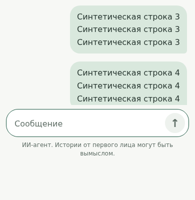
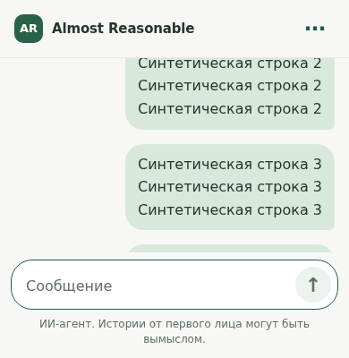

# Chat keyboard viewport correction

## Diagnosis and limits

PR #75 sizes the body to `100dvh` and the flex shell to that body's height.
The conversation already has `min-height: 0` and independent overflow, so an
unshrinkable history is not the demonstrated failure. The shell remains in
document flow, however: document scrolling moves both the header and composer,
and neither the shell height nor its origin follows the visible viewport.

The layout viewport, dynamic CSS viewport, and visual viewport need not shrink
together when a keyboard opens. Focus can also scroll the document or pan the
visual viewport. [CSS viewport units can exclude keyboard effects](https://www.w3.org/TR/css-values-4/#viewport-relative-lengths),
while [VisualViewport exposes the visible height and offset](https://developer.mozilla.org/en-US/docs/Web/API/VisualViewport).
A desktop window resize alone does not exercise those independent states.

Native iOS verification was unavailable: the development environment is
Linux/WSL, without Xcode, an iOS Simulator, or a connected iPhone. The referenced
owner screenshot was not available in this chat. The owner later supplied “26”,
interpreted as iOS 26; the minor version and in-app browser remain unidentified.
The following reproduction establishes a layout
defect consistent with the report, not the exact sequence of native events on
that phone. Standalone Safari and an embedded browser must be checked separately;
their viewport resizing and focus scrolling may differ.

## Reproduction and correction

The regression uses the existing authenticated HTTPS synthetic fixture and real
chat assets/CSP, with 40 stored synthetic messages and no model calls. An
EventTarget substitutes for VisualViewport. The test changes visible height and
offset independently, with and without a layout resize. A test-only extra root
extent allows an explicit document scroll to model retained focus displacement.
A CSS response substitution models a nonzero safe-area inset. These are contract
simulations, not a native keyboard, native safe-area measurement, or iOS timing.

One simulated state has a 500px layout height, a 400px visible height, a 30px
visible offset, 120px document scroll, and a 34px bottom safe area:

| Measurement | PR #75 | CSS fixed shell alone | Correction |
| --- | ---: | ---: | ---: |
| Header top relative to visible top | -150px | -30px | 0px |
| Shell bottom relative to visible bottom | -50px | +70px | 0px |
| Gap below disclosure | 84px | obscured | 12px |

For example, the original gap is `30 + 400 - (500 - 120 - 34) = 84`.
The same document displacement removes the header from view. With no layout
resize, the original composer instead remains below the visible area. Both
regressions fail on the original assets and with the fixed-shell CSS alone.

The correction fixes the chat shell to layout-viewport coordinates, using the
reported visual height and `offsetTop` at scale 1. It does not add `scrollY` to
that fixed position, subtract an inferred keyboard height, or force scrolling.
Viewport resize/scroll, window resize, and page restoration schedule one update
per animation frame. Pinch zoom removes the overrides so the browser retains
normal zoom and pan behavior. Without VisualViewport, the fixed shell uses its
CSS viewport fallback.

The header and composer do not flex-shrink; history takes the remaining space
and keeps its existing scroll position. The multiline editor retains its 160px
cap but also fits within a quarter of the usable height, leaving room for the
controls in landscape. When visual height is smaller than layout height, the
shell drops the home-indicator padding and keeps the existing intentional 12px
bottom spacing; otherwise the normal safe-area inset applies. No keyboard
padding is added. Authentication, disclosure text, storage/recovery, submission,
and retry code are unchanged.

## Synthetic before/after evidence

These are 390 × 400 Chromium crops of the modeled visible region; no native
keyboard or browser accessory bar is rendered. All message text is synthetic.

| Before | After |
| --- | --- |
|  |  |

[After dismissal, with a retained multiline draft](simulated-closed.png).

`tests/test_ui_refresh_browser.py` covers both resize models, repeated focus and
blur, offset-only events, keyboard dismissal with document scroll retained,
mobile multiline Enter, bounded editor scrolling, history reading position,
draft recovery, rotation, toolbar changes, page restoration, zoom opt-out,
feature-detection fallback, desktop resizing, and surrounding-page isolation.
Existing browser tests continue to cover submission, retries, IME behavior,
privacy, and authentication. Simulated checks cannot establish native keyboard
animation, caret scrolling, or actual embedded-browser viewport reporting.

## Scroll-follow regression in the initial fix

The follow-up browser regression confirms the finding on commit `546ea82`.
Starting at the actual bottom with 40 synthetic messages, reducing the visual
height from 800px to 400px leaves the conversation 400px from its end; the last
message ends about 386px below the visible history. This fails both with an
unchanged layout viewport and when the layout shrinks before the visual viewport
callback. The older-history controls pass. These are simulated viewport results,
not a reproduced native iPhone session.

The initial fix preserves the scroll offset but loses the intent to follow the
latest message. Recomputing the existing 180px `nearBottom()` test after the size
change incorrectly classifies a following user as reading older history. Reading
that geometry only at the start of `fitViewport()` is insufficient: CSS
`max-height` can already have changed it during a layout resize.

The correction remembers follow intent and the last observed scroll position
before geometry changes. An actual position change refreshes that intent with
the unchanged 180px policy; a queued scroll event with unchanged position does
not invalidate it. A feature-detected ResizeObserver applies the same state when
the conversation changes size, including multiline composer growth. Submission
and history rendering use this same state and restoration function. This adds
no delay, viewport-specific scroll rule, or unconditional resize-to-bottom.

The new four-case regression asserts actual bottom distance and last-message
bounds for both resize models and both following/older-history positions. It
covers three keyboard cycles, multiline editor growth, three synthetic send/reply
round trips per case, deliberate scrolling away and returning, and scrolling
away while a fake-transport reply is held pending. The original alignment,
draft recovery, zoom, and desktop checks remain in place.

## Owner's native iPhone check

Use an owner-approved test build with a synthetic account, preseeded scrollable
history, and no paid model calls. Record iPhone/iOS and the browser/app version.

1. Check standalone Safari, then the exact in-app browser from the report. Scroll
   to an older message, tap the editor, and wait for the native keyboard animation
   to settle. The header, editor, send button, and disclosure should be visible;
   only the intended bottom spacing should remain above the accessory bar.
2. Start at the bottom and verify that the latest message remains visible through
   keyboard opening, multiline typing, and a synthetic send/reply. Scroll to older
   history and check that subsequent changes respect that reading position. Type
   more than six lines, scroll inside the editor, and dismiss and reopen the
   keyboard three times. Verify the draft, caret, reading position, and header
   restoration without residual displacement.
3. Rotate with the keyboard open, dismiss it, and expand/collapse browser toolbars.
   Check the controls again. Pinch zoom and pan, then return to normal scale.
4. Capture synthetic before/after images and, if Web Inspector is available,
   record `document.documentElement.clientHeight`, `document.body.clientHeight`,
   `scrollY`, and `visualViewport.height`, `.offsetTop`, and `.scale` before focus,
   after the animation, and after dismissal. If the in-app host reports an
   incorrect visual viewport, retain those measurements for a targeted follow-up.
